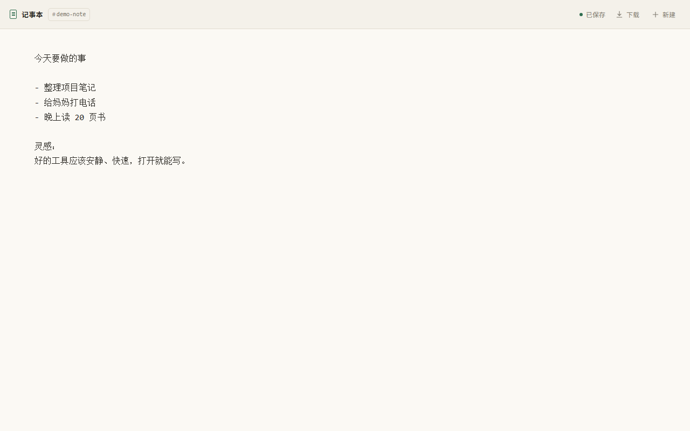

# 记事本 · Go

一个无数据库、直接读写磁盘文件的极简纯文本记事本。单个静态二进制，无外部依赖，适合单核 128 MB 的 Ubuntu 服务器。




## 功能

- 打开 `/` 自动跳转到一个随机文档地址，并直接进入编辑界面。
- 文档用 URL 区分：`/<id>`，例如 `/demo-note`。
- 输入停止约 0.7 秒后自动保存；持续输入时最多每 5 秒保存一次。
- `Ctrl+S` / `Cmd+S` 立即保存；离开页面前会尽力补一次保存。
- 保存失败自动退避重试，网络恢复后继续保存；下载按钮会先保存当前内容再下载。
- 纯文本 `<textarea>`，没有富文本、工具栏或数据库。
- 下载接口：`GET /<id>/download`，以附件形式返回 `<id>.txt`。
- 原子写入：临时文件 + `fsync` + `rename`，读取方不会看到半截文件。
- 自带移动端布局、深色模式、CSP 等安全响应头。

## 快速运行

### 直接运行已编译版本（Linux amd64）

将 `dist/notebook-linux-amd64` 上传到 Ubuntu 后：

```bash
chmod +x notebook-linux-amd64
./notebook-linux-amd64 -addr 127.0.0.1:8080 -data ./data
```

浏览器打开 `http://127.0.0.1:8080/`。默认监听 `:8080`，用 `-addr` 或 `NOTEBOOK_ADDR` 修改。

### 从源码构建

需要 Go 1.22 或更高版本：

```bash
CGO_ENABLED=0 GOOS=linux GOARCH=amd64 \
  go build -trimpath -ldflags="-s -w" -o dist/notebook-linux-amd64 .
```

ARM64 服务器把 `GOARCH` 改成 `arm64` 即可。生成的是静态二进制，目标机器不需要安装 Go。

本地开发：

```bash
go test ./...
go run . -addr 127.0.0.1:8080 -data ./data
```

## 配置

命令行参数优先于环境变量。

| 环境变量 | 命令行参数 | 默认值 | 说明 |
| --- | --- | --- | --- |
| `NOTEBOOK_ADDR` | `-addr` | `:8080` | 监听地址，例如 `127.0.0.1:8080` |
| `NOTEBOOK_DATA_DIR` | `-data` | `./data` | 文档存储目录，不存在时自动创建 |
| `NOTEBOOK_MAX_BYTES` | `-max-bytes` | `1048576`（1 MiB） | 单篇文档最大字节数，范围 1 KiB–16 MiB |
| — | `-version` | — | 输出版本号并退出 |

示例：

```bash
NOTEBOOK_ADDR=127.0.0.1:8080 \
NOTEBOOK_DATA_DIR=/var/lib/notebook \
NOTEBOOK_MAX_BYTES=2097152 \
./notebook-linux-amd64
```

## URL 与接口

| 方法与路径 | 说明 |
| --- | --- |
| `GET /` | 生成一个 8 位随机 ID，`302` 跳转到 `/<id>` |
| `GET /<id>` | 编辑页面；文档不存在时显示空白编辑器 |
| `GET /<id>/download` | 下载 `<id>.txt`，带 `Content-Disposition: attachment` |
| `PUT /<id>` | 直接以请求体保存 UTF-8 文本，`Content-Type: text/plain`，成功返回 `204` |
| `POST /<id>` | 同上，供 `sendBeacon` 和简单脚本使用 |

- `id` 允许 1–64 个字符：`A-Z`、`a-z`、`0-9`、`_`、`-`。
- 新文档的第一次保存才会创建文件；未保存过的文档下载会返回 `404`。
- 文件保存在数据目录下的 `<id>.txt`，权限为 `0600`。
- 不存在的 ID 只要格式合法，打开就是空白编辑器；可以手动输入 URL 创建有意义的 ID，但这类 ID 也可被猜到。

用 `curl` 保存和下载：

```bash
curl -fsS -X PUT \
  -H 'Content-Type: text/plain; charset=utf-8' \
  --data-binary @note.txt \
  http://127.0.0.1:8080/my-note

curl -fOJ http://127.0.0.1:8080/my-note/download
```

## 部署到 Ubuntu

以下示例使用独立的 `notebook` 系统用户、`/opt/notebook` 程序目录和 `/var/lib/notebook` 数据目录。

```bash
sudo useradd --system --home /var/lib/notebook --shell /usr/sbin/nologin notebook
sudo install -d -o root -g root -m 0755 /opt/notebook
sudo install -d -o notebook -g notebook -m 0750 /var/lib/notebook
sudo install -m 0755 notebook-linux-amd64 /opt/notebook/notebook
```

复制并启用 systemd 服务：

```bash
sudo cp deploy/notebook.service /etc/systemd/system/notebook.service
sudo systemctl daemon-reload
sudo systemctl enable --now notebook
sudo systemctl status notebook
```

示例 systemd 服务只监听 `127.0.0.1:8080`，建议在前方放 Nginx 并启用 HTTPS。示例配置见 [deploy/nginx-notebook.conf](deploy/nginx-notebook.conf)：

```bash
sudo cp deploy/nginx-notebook.conf /etc/nginx/sites-available/notebook
sudo ln -s /etc/nginx/sites-available/notebook /etc/nginx/sites-enabled/notebook
sudo nginx -t && sudo systemctl reload nginx
```

修改 `server_name`，按需启用 HTTPS。查看日志：

```bash
journalctl -u notebook -f
```

### 128 MB 内存下的设置

`deploy/notebook.service` 已包含：

- `GOMAXPROCS=1`：单核不创建多余调度线程。
- `GOMEMLIMIT=64MiB`：给 Go 运行时设置软内存上限。
- `MemoryMax=128M`：systemd 层兜底。
- 默认单篇文档上限 1 MiB，避免并发大文档把内存吃满。

如果整台机器只有 128 MB，Nginx、系统进程和 Go 进程需要共享内存；建议使用精简的 Ubuntu Server，并按实际监控结果调整 `GOMEMLIMIT`、`MemoryMax` 和 `NOTEBOOK_MAX_BYTES`。

## 安全说明

**应用本身没有登录功能。** 知道某个文档 URL 的人就能读取和修改该文档；知道 `/` 的人可以不断创建新文档。请至少选择一种保护方式：

- 放在内网 / Tailscale / WireGuard 后面；
- 用 Nginx `auth_basic` 加一层登录（示例配置中有注释）；
- 在公网部署时启用 HTTPS，并限制访问来源。

随机 ID 使用 8 位、27 个易读字符，约有 2.8×10¹¹ 种组合；但手动指定的 ID（如 `/work`）不具备这种强度。另请注意：

- 应用没有多用户权限模型；同一文档多标签页编辑时以最后一次保存为准。
- 数据目录需要纳入备份，例如：
  ```bash
  sudo tar czf /root/notebook-$(date +%F).tar.gz -C /var/lib notebook
  ```
- 文件直接以 `.txt` 保存，迁移和备份都不需要数据库工具。

## 项目结构

```text
.
├── main.go                 # 配置、启动、关闭、随机 ID
├── app.go                  # HTTP 路由、页面、保存与下载
├── store.go                # 磁盘存储、原子写入
├── main_test.go            # 接口、安全、并发测试
├── templates/index.html    # 编辑页面
├── static/                 # CSS、JavaScript、图标
├── deploy/                 # systemd 与 Nginx 示例
├── dist/                   # 构建产物
├── docs/                   # 界面截图
└── old_php/                # 旧版应用，仅供对照，不参与运行
```

## 测试

```bash
go test ./...
go vet ./...
```

测试覆盖了保存/下载/空文档、HTML 转义、非法 ID 与路径穿越、方法限制、UTF-8 校验、大小限制、静态资源、并发写入和响应头。
